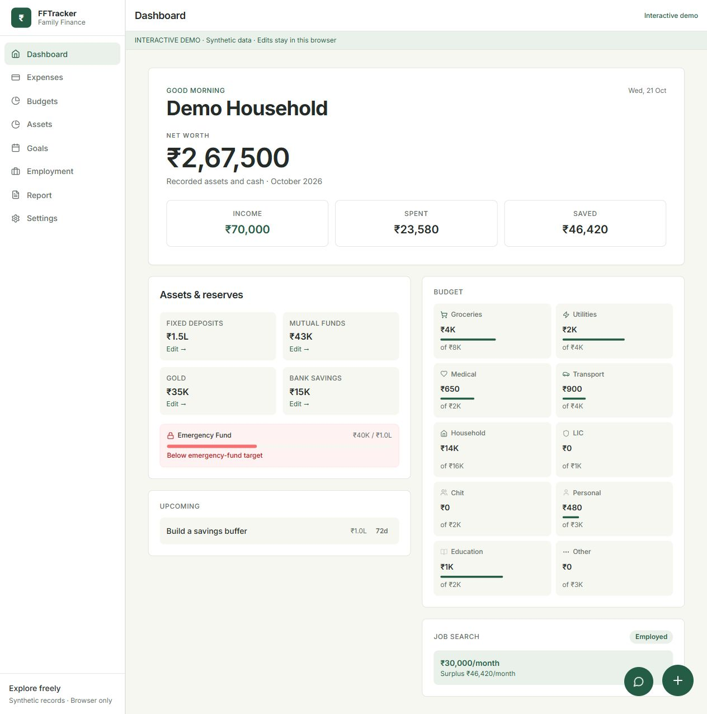
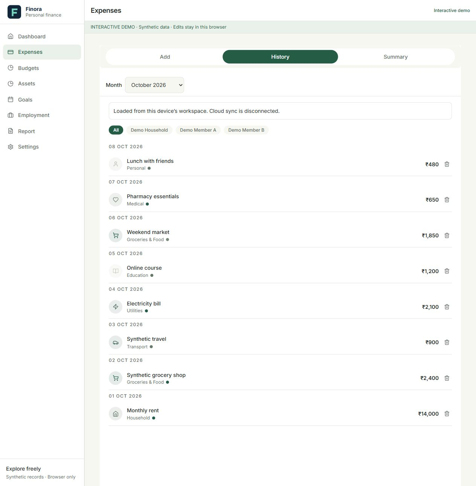
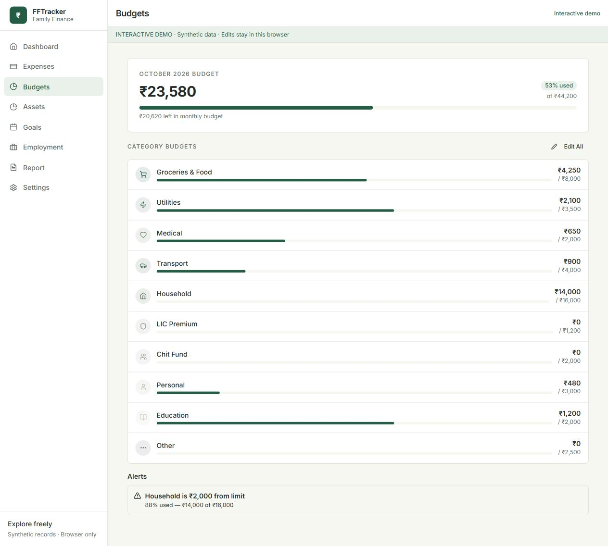
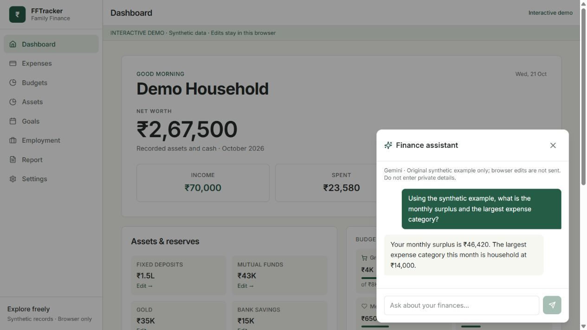

# Finora

**Your finances, clearly understood.**


[](https://scintillating-donut-a597ff.netlify.app/)
[](https://react.dev/)
[](https://fastapi.tiangolo.com/)
[](https://www.postgresql.org/)
[](https://ai.google.dev/)

Personal finance tracking and analytics: explore expenses, budgets, assets, goals, monthly reports and a Gemini assistant through an isolated synthetic portfolio demo. Finora is the new coined product name for the existing Family Finance Tracker project; the repository, hosting projects and URLs remain unchanged.

**[Open the live demo →](https://scintillating-donut-a597ff.netlify.app/)**

**Live branding:** Finora is published on the existing Netlify site and verified in the browser, including its F monogram and favicon. Automatic publishing remains paused.

The public site opens directly into a synthetic household. No account, PIN or email is required. Edit records freely: demo changes stay in your browser and never reach the private household database.

## Explore the demo

- **Dashboard:** recorded net worth, monthly income, expenses, savings and upcoming goals.
- **Expenses:** categorized entries, recurring transactions, monthly history, filtering and deletion acknowledgements.
- **Budgets:** editable category limits, spending progress and overspend indicators.
- **Assets:** fixed deposits, mutual funds, insurance, savings groups and gold.
- **Goals and employment:** editable milestones, application tracking and budget-based income projections.
- **Reports:** monthly cash flow, asset breakdown, alerts, local snapshots and report export.
- **Settings:** editable synthetic household details, income, browser backups and a demo-only reset.

All balances, names, transactions and notes in the public demo are fictional. The finance assistant calls Gemini through FastAPI using a server-owned synthetic example. Browser financial records and edits are never uploaded by demo chat. Do not enter private details into demo questions.

## Finora production screenshots

These four genuine captures were recorded from **Finora running in production on 21 October 2026**. They use only the fictional demo household. The Finora wordmark and F monogram are visible throughout. The current Netlify frontend commit is not independently exposed by the read-only checks used for this closeout, so no deployed frontend SHA is asserted here.

### Dashboard

Income, recorded assets, expenses and savings for the fictional household.



### Expense history

Monthly records and member filters. Financial edits persist in this browser, not the production database.



### Budgets

Category spending, editable limits and near-limit alerts.



### Gemini assistant — verified production response

A genuine Gemini response explains the example’s ₹46,420 monthly surplus: ₹70,000 income minus ₹23,580 expenses. The assistant uses the server-owned example; browser edits are excluded.



## Stack and architecture

| Layer | Implementation |
| --- | --- |
| Frontend | React 18, Vite, React Router, Zustand |
| UI | Tailwind CSS, shared design tokens, Lucide icons, Recharts |
| Browser persistence | Separate demo and personal localStorage namespaces; session-scoped unlock state |
| API source | Python, FastAPI, Pydantic and SQLAlchemy |
| Database | PostgreSQL hosted on Supabase, accessed directly by the backend |
| Hosting | Existing Netlify frontend and Vercel backend projects |
| PWA | Service-worker app shell; API requests configured as network-only |

```text
Public demo → React
              ├─ Financial edits → browser repository → fft_demo_data_v2
              └─ Chat → FastAPI /api/demo/ai/chat → fixed synthetic context → Gemini

Owner /personal/ → profile/PIN → browser repository → fft_data
                               (device-local; cloud sync disconnected)

Separate protected API → verified household identity → SQLAlchemy → PostgreSQL
```

The URL selects the workspace. Public links always enter the demo; `/personal/` deliberately opens the separate owner entry. A stale session marker cannot change that boundary. Demo initialization and reset never read personal records, PINs or recovery archives. Earlier demo storage is retained rather than silently migrated into either workspace.

### Personal persistence: current limitation

The owner’s existing browser PIN flow is preserved, but it is **not server authentication**. The guarded backend currently validates allowlisted Supabase identities, while the browser PIN workspace supplies no such identity. Personal changes therefore remain device-local; cross-device database synchronization is **not connected**. No email-link login is presented in the app.

Before using this release for new historical household entries, a separate approved server-authentication integration is needed. That integration must load existing database records, acknowledge server writes before updating caches, and preserve drafts on failure. Do not assume a browser save is a database save. This release does not reset, seed, migrate or change permissions on the production database.

## Engineering details

- Pure financial calculations are shared with regression tests. Reports include legacy expense categories instead of silently dropping them.
- Month validation and failed-write/delete handling protect the request contracts.
- The backend includes authentication/household authorization, disabled destructive reset, AI input limits, protected-response `no-store`, CORS error handling, request-body limits and per-process rate limiting.
- Per-process throttling is not a global Vercel rate-limit guarantee. Hosted infrastructure enforcement must be verified separately.
- Browser recovery preserves original source bytes and keeps differing record versions for explicit review. It is unavailable to the demo.
- The chat assistant uses the existing `google-genai` SDK and `gemini-2.5-flash-lite`, with bounded input, timeout, explicit retry and sanitized provider failures. It never substitutes a local summary for a provider answer.
- Public chat accepts only a question and up to six recent messages; client-supplied financial context is rejected. The server owns the original fictional example (income ₹70,000; expenses ₹23,580; assets ₹2,67,500). Local demo edits are deliberately excluded and this is disclosed in the chat.
- Personal AI uses the guarded `/api/ai/chat` route. The existing browser PIN cannot authorize it: without a genuine server-verified household session it fails closed. No email-login UI has been added.
- The public AI endpoint is read-only and has no database dependency or tools. Its shared per-process 20-request/minute provider budget is best-effort, not distributed abuse prevention; provider quotas/billing controls remain necessary.

## Run locally

Requires Node.js 22+ and npm; Node.js 24 is recommended for running the tests on Windows. From the repository root:

```sh
cd familyfinancetracker
npm ci
npm run dev
```

Open the URL Vite prints. `/` opens the interactive demo; `/personal/` opens the owner PIN workspace. The demo data needs no database or Supabase credentials. Real chat requires a running backend with a valid server-side Gemini credential; no provider key belongs in the frontend.

### Optional backend development

Use a **local or isolated development PostgreSQL database**, never production. From the repository root:

```sh
python -m venv .venv
# Activate .venv using your shell's normal activation command.
python -m pip install -r backend/requirements.txt
cd backend
uvicorn main:app --reload
```

Configure secrets privately using your local environment. Never commit `.env` files or paste connection strings into issues. Existing backend environment files may refer to a household database: verify the target privately before starting the backend. For local chat, set frontend `VITE_API_URL` to the local backend origin and include the Vite development origin in backend `FRONTEND_URL` before starting the servers. Do not point local financial tests at production.

| Variable name | Purpose |
| --- | --- |
| `SUPABASE_DATABASE_URL` | Backend SQLAlchemy PostgreSQL connection |
| `SUPABASE_URL` | Backend identity-verification project URL |
| `SUPABASE_PUBLISHABLE_KEY` | Backend Supabase Auth verification key |
| `FAMILY_EMAIL_PROFILES` | Server-controlled approved identity-to-profile mapping |
| `FRONTEND_URL` | Explicit backend CORS origin allowlist |
| `GEMINI_API_KEY` | Backend-only Gemini provider credential required for real AI responses |
| `VITE_API_URL` | Backend URL for real AI requests; financial demo transport remains local |

The public demo does not need `VITE_SUPABASE_URL` or `VITE_SUPABASE_PUBLISHABLE_KEY`. Existing hosting variables are preserved; their presence does not enable private synchronization.

Do not run historical seed/restore scripts against a household database. The repository does not have a verified complete PostgreSQL schema baseline for bootstrapping a fresh production installation.

## Tests and production build

```sh
cd familyfinancetracker
npm test
npm run build
```

The frontend suite uses synthetic records, mocked transports and blocked external calls. Windows Node.js 22.20 can crash in the experimental VM-module test harness; the installed Node.js 24 runtime completes the suite. It covers PIN behavior, workspace isolation, acknowledgement failures, recovery preservation, financial calculations and router behavior.

Backend regression suites are Python `unittest` tests using SQL-free guards or synthetic SQLite:

```sh
python -m unittest discover -s backend/tests -p "test_*.py"
```

Local tests do not prove hosted PostgreSQL behavior or authenticated cross-device workflows. The production build currently emits a bundle-size warning; code splitting is a future performance improvement, not a claim of failed functionality.

## Hosting and release status

Netlify uses `familyfinancetracker` as its base, `npm run build` and `dist` output. Its production branch is `main`; automatic publishing is paused. Vercel hosts the separate FastAPI project using its existing Git integration and `backend/vercel.json`. No hosting settings were changed for this documentation release.

At this closeout, the Netlify frontend and Vercel `/health` URL both returned HTTP 200. Vercel identifies the production backend deployment as `READY` at repository commit `46d9d162949b7c029ae9ceba41ce8c00df2f7e2c`. The Netlify frontend SHA was not independently verifiable, so the earlier screenshot/branding evidence remains historical rather than a new commit-level deployment claim. None of these checks establishes personal cloud synchronization or production database role privileges.

The Finora branding release changed presentation assets, visible brand text and metadata; authentication, API behavior, financial logic and storage keys were unchanged. The last complete verification at functional checkpoint `f794d8a` was **95 backend tests and 189 frontend tests passing, zero failures or skips**, plus a successful production build with the bundle-size warning. Branding verification at `5d60cc3` passed **17 focused route/session/demo tests, zero failures or skips**, and the production build. This subsequent documentation/screenshot refresh changes no runtime code; those suites and the build were not rerun.

Finora’s manual frontend publication is complete; Netlify automatic publishing remains paused. This documentation-only refresh needs no manual frontend or backend deployment. Existing Vercel Git integration may create builds automatically when `main` moves; compare runtime source and actual platform metadata. The handoff records point-in-time deployment identifiers and safe resumption instructions.

## Repository and release links

- [Public demo](https://scintillating-donut-a597ff.netlify.app/)
- [Source on the default branch](https://github.com/Nithish-kumar-git/family-finance-tracker)
- [Project handoff and resumption guide](docs/FAMILY_FINANCE_TRACKER_HANDOFF.md)
- [Implementation history](https://github.com/Nithish-kumar-git/family-finance-tracker/tree/codex/finance-reliability-20261016)
- [Backend health](https://family-finance-tracker-pearl.vercel.app/health) — separate from the public demo’s browser persistence

The public frontend and backend are independently deployed. A frontend publication does not imply that the matching backend revision was deployed or that personal database synchronization works.
